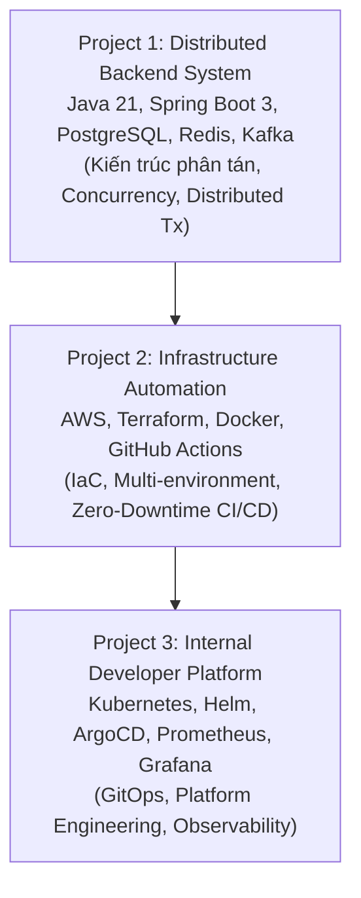

# 04 — Signature Capstone Projects

Thay vì tạo ra hàng chục dự án demo/tutorial bề nổi, repo này tập trung xây dựng **3 dự án lớn có chiều sâu kiến trúc thực tế** trong lộ trình 2 năm.

---

## 🎯 Danh mục 3 Dự án Trọng điểm

| Dự án | Lĩnh vực trọng tâm | Stack công nghệ | Mục tiêu năng lực chứng minh |
| :--- | :--- | :--- | :--- |
| **[01 — Distributed Backend System](file:///d:/pkucpkam/repo-git/daily-engineering-lab/04-projects/01-distributed-backend-system/README.md)** | SE & Distributed Systems | Java 21, Spring Boot, PostgreSQL, Redis, Kafka | Concurrency, Caching strategies, Outbox pattern, Saga distributed transactions, Idempotency |
| **[02 — Infrastructure Automation](file:///d:/pkucpkam/repo-git/daily-engineering-lab/04-projects/02-infrastructure-automation/README.md)** | Cloud & Automation | AWS, Terraform, Docker, GitHub Actions | Modular IaC, multi-env state management, automated canary/blue-green deployment & auto-rollback |
| **[03 — Internal Developer Platform](file:///d:/pkucpkam/repo-git/daily-engineering-lab/04-projects/03-internal-developer-platform/README.md)** | DevOps & Platform Eng | K8s, Helm, ArgoCD, Prometheus, Grafana | GitOps workflow, self-service developer platform, standardized microservice charts, RED monitoring |
