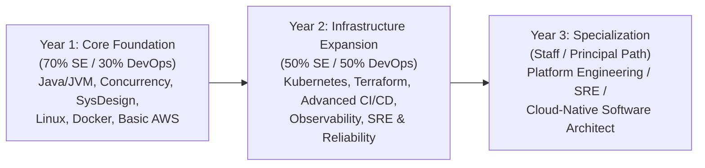

# Software Engineering Mastery & Cloud-Native DevOps Lab

> **A structured, production-grade engineering lab for mastering Software Engineering and Cloud-Native DevOps.**  
> Focus on depth over superficial frameworks, distributed systems, internal mechanics, and battle-tested infrastructure.

---

## 🎯 Purpose & Philosophy

This repository is a personal engineering laboratory designed to systematically level up from a Backend Engineer to a **Senior/Master Software Engineer** and **Cloud-Native / DevOps Architect**.

Instead of collecting tutorials or chasing trendy syntax, this workspace focuses on **high-leverage, foundational capabilities that withstand AI competition**:

1. **System Design & Distributed Systems** — End-to-end distributed system design, consensus, partitioning, and failure modes.
2. **Database & Systems Internals** — Concurrency control, MVCC, indexing mechanics, lock contention, and connection pool exhaustion.
3. **Cloud-Native DevOps & SRE** — Infrastructure as Code, container orchestration (Kubernetes), automated GitOps pipelines, and observability (metrics/logs/traces).
4. **Production Troubleshooting** — Rigorous debugging under pressure, hypothesis validation, and blameless post-mortem analysis.
5. **3 Capstone Projects** — Depth-first implementation of real-world distributed architectures.

---

## 🗺️ 3-Year Strategic Roadmap

The complete strategy, priority matrix, and deep questions are detailed in [ROADMAP.md](./ROADMAP.md).



| Giai đoạn | Trọng tâm | Tỷ lệ | Mục tiêu đầu ra |
| :--- | :--- | :--- | :--- |
| **Năm 1 — Foundation** | Java nâng cao, JVM internals, Concurrency, System Design, DB tuning, Linux, Docker, AWS cơ bản | 70% SE<br>30% DevOps | Tự thiết kế, code và deploy ứng dụng backend phân tán hoàn chỉnh. |
| **Năm 2 — Infrastructure** | Kubernetes, Helm, Terraform, CI/CD nâng cao, Prometheus/Grafana, Tracing, Chaos Engineering | 50% SE<br>50% DevOps | Thiết kế hạ tầng dạng code (IaC), tự động hóa delivery và vận hành production chịu tải. |
| **Năm 3 — Specialization** | Platform Engineering / SRE / Senior Cloud-Native Software Architect | Định vị chuyên sâu | Thiết kế giải pháp cấp độ toàn hệ thống (system-wide), dẫn dắt kiến trúc kỹ thuật lớn. |

---

## 📊 Tiến độ hiện tại (2026-11-27)

> Xem bảng đầy đủ 234 mục tại [CURRICULUM.md](./CURRICULUM.md). Trạng thái: 🔲 todo · ✍️ draft (đã soạn) · 👀 review (đang học) · ✅ done (qua explain-back).

- **Giáo trình đã soạn (`✍️ draft`):** **`43 / 234` (`18.4%`)** · **Đang học (`👀`):** `0` · **Hoàn thành (`✅`):** `0` · **Chờ soạn (`🔲`):** `191`
- **Các giai đoạn đã/đang triển khai:**
  - **Quý 0 · Bridge (`9 / 9` — `100%`):** [GIT-01..04](./00-foundations/git-workflow/README.md) · [READ-01..03](./00-foundations/code-reading/README.md) · [JVM-01..02](./01-software-engineering/java-jvm/README.md)
  - **Năm 1 · Q1 (`34 / 41` — `82.9%`):** [JVM-03..10](./01-software-engineering/java-jvm/README.md) · [CQ-01..08](./01-software-engineering/code-quality/README.md) · [AI-01](./01-software-engineering/ai-engineering/README.md) · [LNX-01..15](./02-devops-and-cloud/linux-networking/README.md) · [DSA-01..02](./00-foundations/dsa/README.md)
- **Mục tiêu kế tiếp (hoàn thành Năm 1 · Q1):** `DSA-03..07`, `INC-07..08`.

---

## 📂 Repository Structure

```
daily-engineering-lab/
├── README.md                                  ← Tổng quan & Định hướng repository
├── ROADMAP.md                                 ← Lộ trình 3 năm chi tiết & Ma trận kỹ năng
├── CURRICULUM.md                              ← Danh mục TOÀN BỘ bài học / lab / bài tập (có ID, status)
│
├── docs/
│   ├── CONTENT-GUIDE.md                       ← Quy chuẩn soạn nội dung (cho người & agent)
│   ├── AGENT-PROMPT.md                        ← Prompt giao việc cho agent soạn giáo trình
│   └── templates/                             ← lesson / exercises / solutions / lab / pattern / incident / ADR / weekly-log
│
├── weekly-log/                                ← Nhật ký tuần (người học tự viết, tiếng Anh)
│
├── 00-foundations/                            ← Nền tảng: Quý 0 & Năm 1 Q1
│   ├── git-workflow/                          ← Git internals, rebase, bisect
│   ├── code-reading/                          ← Đọc code không cần AI (HikariCP, Caffeine)
│   └── dsa/                                   ← DSA thực dụng
│
├── 01-software-engineering/                   ← Trục Kỹ thuật Phần mềm Chuyên sâu
│   ├── java-jvm/                              ← Java 7→21, class loading, memory, JIT, GC, heap dump
│   ├── code-quality/                          ← SOLID, refactoring legacy, testing, Testcontainers
│   ├── concurrency/                           ← JMM, thread pool, locks, virtual threads, thread dump
│   ├── database/                              ← PostgreSQL internals: index, planner, MVCC, locking, pool
│   ├── performance/                           ← Percentiles, Little's Law, JMH, load test, profiling
│   ├── backend-architecture/                  ← Spring internals, API, caching, resilience, architecture
│   ├── distributed-systems/                   ← Replication, consensus, Kafka, Outbox, Saga, locks
│   ├── security/                              ← OWASP, OAuth2/OIDC, JWT, injection, threat modeling
│   ├── ai-engineering/                        ← AI-assisted dev, embeddings, RAG, LLM prod, agents
│   ├── system-design/                         ← Phân tích & thiết kế hệ thống phân tán
│   ├── patterns/                              ← Pattern cards (Reliability, Data, Messaging...)
│   ├── concept-decisions/                     ← Trade-off analyses (A vs B, có số đo)
│   └── notes/                                 ← Deep-dive notes tự do
│
├── 02-devops-and-cloud/                       ← Trục DevOps, Cloud & SRE
│   ├── linux-networking/                      ← Process, memory, fd, epoll, TCP, DNS, TLS, Nginx
│   ├── containers-k8s/                        ← Docker internals, JVM in container, Kubernetes, Helm
│   ├── aws-cloud/                             ← IAM, VPC, EC2, RDS, S3, ALB, CloudWatch, cost
│   ├── iac-terraform/                         ← Terraform, Ansible, Vault, AWS Multi-AZ
│   ├── ci-cd-pipelines/                       ← GitHub Actions, Jenkins, deploy strategies, GitOps
│   └── observability-sre/                     ← Prometheus, Grafana, OTel, SLO, alerting, chaos
│
├── 03-production-troubleshooting/             ← Kỹ năng Gỡ lỗi & Quản trị Sự cố Production
│   ├── incident-labs/                         ← Sự cố tái hiện có chủ đích để luyện điều tra
│   ├── bug-cases/                             ← Bug thật (Symptom → Hypothesis → Root Cause)
│   └── post-mortems/                          ← Phân tích sự cố thực tế và giải pháp phòng ngừa
│
└── 04-projects/                               ← 3 Dự án Trọng điểm (mỗi project: MILESTONES.md + adr/)
    ├── 01-distributed-backend-system/
    ├── 02-infrastructure-automation/
    └── 03-internal-developer-platform/
```

### 📖 Cách dùng repo mỗi ngày

1. Mở [CURRICULUM.md](./CURRICULUM.md) → lấy bài tiếp theo của giai đoạn hiện tại.
2. Đọc lý thuyết (`README.md` của bài) → làm `exercises.md` → chạy `lab/`.
3. Tự viết `my-notes.md` + làm explain-back (5 phút, không nhìn tài liệu). Qua được → đổi status sang ✅.
4. Chủ nhật: viết `weekly-log/`.

Mỗi bài học là một thư mục chuẩn: `README.md` (lý thuyết) · `exercises.md` · `solutions.md` · `lab/` · `my-notes.md`. Quy chuẩn: [docs/CONTENT-GUIDE.md](./docs/CONTENT-GUIDE.md).

---

## 🚀 The 3 Signature Projects

Thay vì làm hàng chục project tutorial bề nổi, repo này tập trung xây dựng 3 hệ thống thực chiến:

### 1. [Distributed Backend System](./04-projects/01-distributed-backend-system/README.md)
* **Stack:** Java 21+, Spring Boot 3, PostgreSQL, Redis, Apache Kafka.
* **Mục tiêu:** Chứng minh năng lực thiết kế hệ thống chịu tải cao, xử lý đồng thời (concurrency), distributed locks, Outbox pattern và distributed transactions (Saga).

### 2. [Infrastructure Automation](./04-projects/02-infrastructure-automation/README.md)
* **Stack:** AWS, Terraform, Docker, GitHub Actions, HashiCorp Vault.
* **Mục tiêu:** Tự động hóa 100% việc tạo hạ tầng multi-environment (dev/staging/prod), CI/CD pipeline với zero-downtime deployment (Canary/Blue-Green) và tự động rollback khi gặp sự cố.

### 3. [Internal Developer Platform](./04-projects/03-internal-developer-platform/README.md)
* **Stack:** Kubernetes, Helm, ArgoCD, Prometheus, Grafana, Loki/Tempo.
* **Mục tiêu:** Xây dựng nền tảng Platform Engineering giúp developer tự phục vụ (self-service) deploy microservices, quản trị ingress/TLS, và theo dõi metrics/logs tập trung.

---

## 🛡️ Core Engineering Rules

1. **Reason first, code second.** Hiểu rõ bài toán và viết ra suy nghĩ logic trước khi chạm vào framework hay template.
2. **Quantify everything.** Không dùng từ chung chung ("traffic cao", "query chậm"). Phải định lượng chính xác: `10,000 req/s`, `p99 latency < 50ms`, `500 connection pool limit`.
3. **Every trade-off must be justified.** Không có giải pháp hoàn hảo, chỉ có sự đánh đổi phù hợp. Mọi quyết định thiết kế phải giải thích tại sao chọn phương án A và bác bỏ phương án B.
4. **Root-cause deep dive.** Khi gặp lỗi, không dừng lại ở việc restart hay vá tạm thời; phải tìm ra tận gốc bản chất cơ chế của hệ thống.
5. **Commit regularly.** Tiến bộ là kết quả của việc tích lũy liên tục và bền bỉ mỗi ngày.
