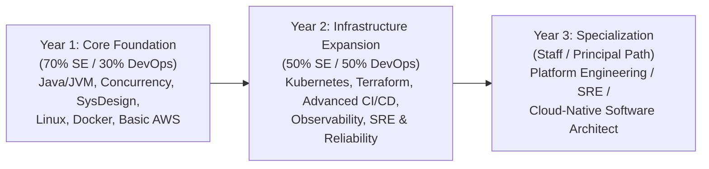

# Software Engineering Mastery & Cloud-Native DevOps Lab

> **A structured, production-grade engineering lab for mastering Software Engineering and Cloud-Native DevOps.**  
> Focus on depth over superficial frameworks, distributed systems, internal mechanics, and battle-tested infrastructure.

---

## 🎯 Purpose & Philosophy

This repository is a personal engineering laboratory designed to systematically level up from a Backend Engineer to a **Senior/Master Software Engineer** and **Cloud-Native / DevOps Architect**.

Instead of collecting tutorials or chasing trendy syntax, this workspace focuses on **high-leverage, foundational capabilities that withstand AI competition**:

1. **System Design & Distributed Systems** — End-to-end distributed system design, consensus, partitioning, and failure modes.
2. **Database & Systems Internals** — Concurrency control, MVCC, indexing mechanics, lock contention, and connection pool exhaustion.
3. **Cloud-Native DevOps & SRE** — Infrastructure as Code, container orchestration (Kubernetes), automated GitOps pipelines, and observability (metrics/logs/traces).
4. **Production Troubleshooting** — Rigorous debugging under pressure, hypothesis validation, and blameless post-mortem analysis.
5. **3 Capstone Projects** — Depth-first implementation of real-world distributed architectures.

---

## 🗺️ 3-Year Strategic Roadmap

The complete strategy, priority matrix, and deep questions are detailed in [ROADMAP.md](file:///d:/pkucpkam/repo-git/daily-engineering-lab/ROADMAP.md).



| Giai đoạn | Trọng tâm | Tỷ lệ | Mục tiêu đầu ra |
| :--- | :--- | :--- | :--- |
| **Năm 1 — Foundation** | Java nâng cao, JVM internals, Concurrency, System Design, DB tuning, Linux, Docker, AWS cơ bản | 70% SE<br>30% DevOps | Tự thiết kế, code và deploy ứng dụng backend phân tán hoàn chỉnh. |
| **Năm 2 — Infrastructure** | Kubernetes, Helm, Terraform, CI/CD nâng cao, Prometheus/Grafana, Tracing, Chaos Engineering | 50% SE<br>50% DevOps | Thiết kế hạ tầng dạng code (IaC), tự động hóa delivery và vận hành production chịu tải. |
| **Năm 3 — Specialization** | Platform Engineering / SRE / Senior Cloud-Native Software Architect | Định vị chuyên sâu | Thiết kế giải pháp cấp độ toàn hệ thống (system-wide), dẫn dắt kiến trúc kỹ thuật lớn. |

---

## 📂 Repository Structure

```
daily-engineering-lab/
├── README.md                                  ← Tổng quan & Định hướng repository
├── ROADMAP.md                                 ← Lộ trình 3 năm chi tiết & Ma trận kỹ năng
│
├── 01-software-engineering/                   ← Trục Kỹ thuật Phần mềm Chuyên sâu
│   ├── system-design/                         ← Phân tích & thiết kế hệ thống phân tán
│   ├── patterns/                              ← Reusable Architectural & Operational Patterns
│   ├── concept-decisions/                     ← Trade-off analyses (SQL vs NoSQL, Lockings, etc.)
│   └── notes/                                 ← Deep-dives (JVM, Transaction Boundary, MVCC, etc.)
│
├── 02-devops-and-cloud/                       ← Trục DevOps, Cloud & SRE
│   ├── linux-networking/                      ← Kernel, Network sockets, TCP/IP, DNS, Performance
│   ├── containers-k8s/                        ← Docker, Kubernetes architecture, Helm, CRDs
│   ├── iac-terraform/                         ← Terraform modules, State management, Cloud infra
│   ├── ci-cd-pipelines/                       ← GitHub Actions, Jenkins, GitOps (ArgoCD)
│   └── observability-sre/                     ← Prometheus, Grafana, OpenTelemetry, SLI/SLO
│
├── 03-production-troubleshooting/             ← Kỹ năng Gỡ lỗi & Quản trị Sự cố Production
│   ├── bug-cases/                             ← Methodical debugging (Symptom → Hypothesis → Root Cause)
│   └── post-mortems/                          ← Phân tích sự cố thực tế và giải pháp phòng ngừa
│
└── 04-projects/                               ← 3 Dự án Trọng điểm Đủ chiều sâu (2 Năm)
    ├── 01-distributed-backend-system/         ← High-throughput, Kafka, Redis, Distributed Tx
    ├── 02-infrastructure-automation/         ← AWS Multi-AZ, Terraform IaC, Automated Rollback
    └── 03-internal-developer-platform/        ← K8s Developer Platform, ArgoCD, Central Observability
```

---

## 🚀 The 3 Signature Projects

Thay vì làm hàng chục project tutorial bề nổi, repo này tập trung xây dựng 3 hệ thống thực chiến:

### 1. [Distributed Backend System](file:///d:/pkucpkam/repo-git/daily-engineering-lab/04-projects/01-distributed-backend-system/README.md)
* **Stack:** Java 21+, Spring Boot 3, PostgreSQL, Redis, Apache Kafka.
* **Mục tiêu:** Chứng minh năng lực thiết kế hệ thống chịu tải cao, xử lý đồng thời (concurrency), distributed locks, Outbox pattern và distributed transactions (Saga).

### 2. [Infrastructure Automation](file:///d:/pkucpkam/repo-git/daily-engineering-lab/04-projects/02-infrastructure-automation/README.md)
* **Stack:** AWS, Terraform, Docker, GitHub Actions, HashiCorp Vault.
* **Mục tiêu:** Tự động hóa 100% việc tạo hạ tầng multi-environment (dev/staging/prod), CI/CD pipeline với zero-downtime deployment (Canary/Blue-Green) và tự động rollback khi gặp sự cố.

### 3. [Internal Developer Platform](file:///d:/pkucpkam/repo-git/daily-engineering-lab/04-projects/03-internal-developer-platform/README.md)
* **Stack:** Kubernetes, Helm, ArgoCD, Prometheus, Grafana, Loki/Tempo.
* **Mục tiêu:** Xây dựng nền tảng Platform Engineering giúp developer tự phục vụ (self-service) deploy microservices, quản trị ingress/TLS, và theo dõi metrics/logs tập trung.

---

## 🛡️ Core Engineering Rules

1. **Reason first, code second.** Hiểu rõ bài toán và viết ra suy nghĩ logic trước khi chạm vào framework hay template.
2. **Quantify everything.** Không dùng từ chung chung ("traffic cao", "query chậm"). Phải định lượng chính xác: `10,000 req/s`, `p99 latency < 50ms`, `500 connection pool limit`.
3. **Every trade-off must be justified.** Không có giải pháp hoàn hảo, chỉ có sự đánh đổi phù hợp. Mọi quyết định thiết kế phải giải thích tại sao chọn phương án A và bác bỏ phương án B.
4. **Root-cause deep dive.** Khi gặp lỗi, không dừng lại ở việc restart hay vá tạm thời; phải tìm ra tận gốc bản chất cơ chế của hệ thống.
5. **Commit regularly.** Tiến bộ là kết quả của việc tích lũy liên tục và bền bỉ mỗi ngày.
