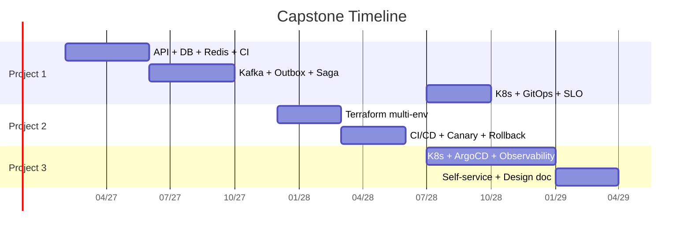

# Kế hoạch & Lộ trình Phát triển Kỹ thuật (Engineering Roadmap)

> Tài liệu kim chỉ nam định hướng học tập và rèn luyện: Đi sâu bản chất Software Engineering & mở rộng năng lực Cloud-Native / DevOps.
> README nói *tại sao*, ROADMAP nói *học gì, theo thứ tự nào, và khi nào được coi là "xong"*.
> Trở về trang chủ: [README.md](./README.md)

---

## Mục lục

1. [Trụ cột Kỹ thuật Cốt lõi](#1-trụ-cột-kỹ-thuật-cốt-lõi)
2. [Nguyên tắc Vận hành](#2-nguyên-tắc-vận-hành)
3. [Những Năng lực Nên Đầu tư Để Ít Bị AI Cạnh Tranh](#3-những-năng-lực-nên-đầu-tư-để-ít-bị-ai-cạnh-tranh)
4. [Skill Matrix](#4-skill-matrix--thang-đo-năng-lực)
5. [Roadmap 3 Năm (chi tiết theo quý)](#5-roadmap-3-năm)
6. [Các Trục Xuyên suốt](#6-các-trục-xuyên-suốt-cross-cutting-tracks)
7. [Bộ Project Nên Xây Dựng Trong 2 Năm](#7-bộ-project-nên-xây-dựng-trong-2-năm)
8. [Tài liệu Học Nên Theo](#8-tài-liệu-học-nên-theo)
9. [Templates](#9-templates)
10. [Quarterly Review Checklist](#10-quarterly-review-checklist)

---

## 1. Trụ cột Kỹ thuật Cốt lõi

### Năng lực nền tảng
- **System Design**
- **Distributed Systems**
- **Database Internals**
- **Performance Optimization**
- **Security**
- **Software Architecture**
- **Production Troubleshooting**

### Phân bổ chủ đề & Nội dung

| Chủ đề | Nội dung chi tiết | Thư mục trong repo |
| :--- | :--- | :--- |
| **SE** | System Design, Architecture, Distributed Systems | `01-software-engineering/` |
| **Backend** | Java, JVM, Concurrency, Performance | `01-software-engineering/notes/` |
| **Database** | Index, Query Optimization, Transaction, MVCC, Locking | `01-software-engineering/notes/` |
| **DevOps** | Linux, Networking, Docker, CI/CD, AWS, Terraform, K8s | `02-devops-and-cloud/` |
| **Troubleshooting** | Debugging, Post-mortem | `03-production-troubleshooting/` |
| **AI** | AI-assisted development, Embeddings & RAG, Agent | `01-software-engineering/notes/ai/` |

---

## 2. Nguyên tắc Vận hành

> Một roadmap 3 năm thất bại vì **mất nhịp**, không phải vì thiếu nội dung. Phần này quan trọng hơn danh sách chủ đề.

### 2.1 Ngân sách thời gian (giả định đi làm full-time)

| Loại | Thời lượng | Nội dung |
| :--- | :--- | :--- |
| **Ngày thường** | 45–60 phút | 1 khối deep work: đọc + ghi note **tự viết, không để AI viết hộ** |
| **Cuối tuần** | 3–4 giờ | Lab thực hành / code project / viết bài tổng kết |
| **Tổng / tuần** | **~8–10 giờ** | ≈ 450 giờ/năm, đủ cho kế hoạch dưới đây |
| **Ngày tối thiểu** | **15 phút** | Ngày bận/mệt: đọc 1 trang, commit 1 dòng note. **Giữ chuỗi, không giữ khối lượng.** |

### 2.2 Nhịp lặp (cadence)

- **Hằng tuần (Chủ nhật, 20 phút):** viết `weekly-log`: đã học gì, 1 câu hỏi còn mở, kế hoạch tuần sau.
- **Hằng tháng:** 1 bài *deep-dive note* hoặc *concept-decision* hoàn chỉnh.
- **Hằng quý:** tự đánh giá theo **Exit Criteria**. Không đạt → kéo dài quý, **không** nhảy cóc.
- **Quy tắc 2 tuần:** bỏ lỡ 2 tuần liên tiếp → giảm phạm vi quý đó, không bỏ cả roadmap.

### 2.3 Quy tắc dùng AI (AI-era discipline)

Mục tiêu là **hiểu sâu hơn AI**, không phải cạnh tranh tốc độ gõ với AI.

1. **Viết trước, hỏi sau:** tự viết giải thích/thiết kế, sau đó mới dùng AI để phản biện.
2. **Không merge code mình không giải thích được** từng dòng (áp dụng cả ở công ty).
3. **Explain-back test:** sau mỗi chủ đề, giải thích lại không nhìn tài liệu trong 5 phút. Không làm được = chưa học xong.
4. Dùng AI như **reviewer & sparring partner**, không như ghostwriter.

---

## 3. Những Năng lực Nên Đầu tư Để Ít Bị AI Cạnh Tranh

Tui xếp theo mức độ ưu tiên:

| Năng lực | Mức độ ưu tiên | Học chủ yếu ở |
| :--- | :--- | :--- |
| **System Design** | Rất cao | Năm 1 Q4 → Năm 3 |
| **Distributed Systems** | Rất cao | Năm 1 Q4, Project 1 |
| **Debugging & Troubleshooting** | Rất cao | Xuyên suốt (`bug-cases/`, `post-mortems/`) |
| **Coding** (đọc, viết, refactor, test) | Rất cao | Quý 0, Năm 1 Q1 |
| **Sử dụng AI hiệu quả** | Rất cao | Xuyên suốt (mục 2.3, 6.1) |
| **Database & Performance** | Cao | Năm 1 Q2 |
| **Cloud Infrastructure** | Cao | Năm 1 Q4, Năm 2 |
| **Security & Reliability** | Cao | Rải đều, Năm 2 Q4 |

> [!TIP]
> **Tư duy cốt lõi:** Đừng hiểu *Master SE* là phải học thật nhiều framework.

Ví dụ, thay vì chỉ học Spring Boot, hãy hiểu sâu bản chất:

| Câu hỏi bản chất | Trả lời được sau |
| :--- | :--- |
| JVM quản lý memory thế nào? | Năm 1 Q1 |
| Thread pool hoạt động ra sao? | Năm 1 Q2 |
| Khi 10.000 request đồng thời thì hệ thống xảy ra chuyện gì? | Năm 1 Q2–Q3 |
| Database connection pool bị cạn thì xử lý thế nào? | Năm 1 Q2 |
| Làm sao thiết kế hệ thống chịu lỗi? | Năm 1 Q3–Q4 |
| Khi deploy phiên bản mới bị lỗi thì rollback ra sao? | Năm 2 Q2 |

*Đây là những kiến thức có giá trị lâu dài hơn việc biết thêm một framework mới.*

---

## 4. Skill Matrix & Thang đo năng lực

| Mức | Định nghĩa | Bằng chứng trong repo |
| :--- | :--- | :--- |
| **L1 — Aware** | Biết khái niệm, đọc tài liệu hiểu | Có note tóm tắt |
| **L2 — Practitioner** | Dùng được trong project, debug được lỗi thường gặp | Có lab chạy được |
| **L3 — Expert** | Giải thích được cơ chế bên trong, chọn trade-off có lý do | Có deep-dive + concept-decision |
| **L4 — Authority** | Thiết kế/review cho người khác, xử lý sự cố chưa có tài liệu | Có post-mortem, design doc, bài chia sẻ |

| Kỹ năng | Hiện tại | Cuối Năm 1 | Cuối Năm 2 | Cuối Năm 3 |
| :--- | :---: | :---: | :---: | :---: |
| CS Fundamentals (DSA, OS, Network) | _?_ | L2 | L3 | L3 |
| Java hiện đại & JVM internals | _?_ | L3 | L3 | L4 |
| Concurrency | _?_ | L3 | L3 | L4 |
| Database internals & tuning | _?_ | L3 | L3 | L4 |
| Performance Optimization | _?_ | L2 | L3 | L4 |
| System Design & Distributed Systems | _?_ | L2 | L3 | L4 |
| Software Architecture | _?_ | L2 | L3 | L4 |
| Code quality / Refactoring / Testing | _?_ | L3 | L3 | L4 |
| Linux & Networking | _?_ | L2 | L3 | L3 |
| Docker | _?_ | L2 | L3 | L3 |
| Cloud (AWS) | _?_ | L1→L2 | L3 | L3 |
| Kubernetes | — | L1 | L3 | L3/L4 |
| IaC (Terraform, Ansible) | — | L1 | L3 | L3 |
| CI/CD & GitOps | _?_ | L2 | L3 | L4 |
| Observability & SRE | — | L1 | L3 | L4 |
| Security (AppSec + Cloud) | _?_ | L1 | L2 | L3 |
| AI Engineering (RAG, Agent) | _?_ | L1→L2 | L2→L3 | L3 |
| Technical Writing (EN) | _?_ | L2 | L3 | L4 |

> 📌 **Việc đầu tiên:** điền cột "Hiện tại" một cách trung thực. Đây là baseline để đo tiến bộ.

---

## 5. Roadmap 3 Năm

> Tui sẽ không chia đều thời gian học tất cả công nghệ. Phải có thứ tự ưu tiên.

### Tổng quan

| Giai đoạn | Tỷ trọng | Nội dung chính | Kết quả cần đạt |
| :--- | :--- | :--- | :--- |
| **Quý 0 — Bridge** | — | Java 8→21, Git nâng cao, đọc code không cần AI | Nền đủ vững để học sâu |
| **Năm 1 — Xây nền tảng (SE First)** | 70% SE / 30% DevOps | Java nâng cao, JVM, concurrency; System Design, Distributed Systems; Database internals, performance tuning; Linux, Networking; Docker, GitHub Actions, Jenkins; AWS cơ bản | Tự thiết kế, phát triển và deploy một ứng dụng hoàn chỉnh |
| **Năm 2 — Mở rộng Infrastructure (DevOps Growth)** | 50% SE / 50% DevOps | Terraform, Ansible; Kubernetes, Helm; CI/CD nâng cao; Prometheus, Grafana, OpenTelemetry; Security, observability; Reliability Engineering | Thiết kế hạ tầng, tự động hóa deployment và vận hành ứng dụng production |
| **Năm 3 — Định vị chuyên môn** | Chọn 1 nhánh | Platform Engineering / SRE / Senior Backend – Software Architect có năng lực Cloud Native | Thiết kế giải pháp cấp hệ thống, đảm nhận trách nhiệm kỹ thuật lớn hơn |

---

### Quý 0 — Bridge Phase (6–8 tuần đầu tiên)

> Lấp lỗ hổng nền tảng **trước khi** đi vào nội dung nâng cao. Nhảy thẳng vào Kafka/K8s khi nền yếu là con đường nhanh nhất để học nông.

| Chủ đề | Nội dung cụ thể | Deliverable |
| :--- | :--- | :--- |
| **Java 8 → 21 bridge** | Lambda, Stream, Optional, `java.time`, `var`, records, sealed classes, pattern matching, text blocks, **Virtual Threads** | `notes/java-8-to-21-cheatsheet.md` + so sánh code Java 7 vs 21 cùng 1 bài toán |
| **Git nâng cao** | rebase, cherry-pick, bisect, reflog, conventional commits | Dùng `git bisect` tìm 1 bug thật |
| **Đọc code không cần AI** | Đọc source 1 thư viện nhỏ (vd. HikariCP, Guava `Cache`), vẽ call-flow | `notes/code-reading-hikaricp.md` |
| **Thiết lập hệ thống** | Template note, weekly-log, điền baseline Skill Matrix | Commit đầu tiên của nhịp học |

**Exit Criteria:** viết lại được một module nhỏ kiểu legacy (Java 7) bằng Java 21 trong lab cá nhân, giải thích được mọi khác biệt.

---

### NĂM 1 — Xây nền tảng kỹ thuật (70% SE / 30% DevOps)

#### Q1 — Language, Code Quality & CS Fundamentals

**Software Engineering**
- **JVM Internals:** class loading, memory model (heap/stack/metaspace), JIT, GC (G1, ZGC), đọc GC log, heap dump với Eclipse MAT / JFR.
- **Clean code có lý do:** SOLID áp dụng thực tế, cohesion/coupling, *deep modules*.
- **Refactoring & legacy code:** characterization tests, seams, strangler pattern. *Áp dụng trực tiếp ở codebase công ty.*
- **Testing:** JUnit 5, Mockito, test pyramid, Testcontainers, khi nào *không* nên mock.
- **DSA thực dụng:** hash map, B-tree, heap, graph, LRU, độ phức tạp. 2–3 bài/tuần, tập trung hiểu, không cày số lượng.

**DevOps**
- **Linux cơ bản:** process, signal, file descriptor, permission, systemd, `top/htop/ps/lsof/strace`.
- Shell scripting: tự động hóa 1 việc lặp lại trong công việc.

**Câu hỏi sâu**
- Tại sao ứng dụng Java bị `OutOfMemoryError: Metaspace` dù heap còn trống?
- Stop-the-world pause ảnh hưởng p99 latency thế nào? ZGC giải quyết bằng cơ chế gì?
- Refactor một class 2.000 dòng không có test, bước đầu tiên là gì và tại sao?

**Exit Criteria:** phân tích được 1 heap dump thật; có ≥ 1 refactoring được merge ở công ty kèm test.

---

#### Q2 — Concurrency, Database Internals & Performance

**Concurrency**
- Java Memory Model, happens-before, `volatile`, `synchronized`, CAS, `Atomic*`.
- `java.util.concurrent`: ExecutorService & **thread pool internals** (core/max size, queue, rejection policy), CompletableFuture, ConcurrentHashMap, ReentrantLock, StampedLock.
- **Virtual Threads vs Platform Threads:** pinning, khi nào virtual thread *không* giúp gì.
- Deadlock, livelock, starvation: tái hiện và đọc thread dump.

**Database (PostgreSQL)**
- Storage: page, heap, TOAST, WAL.
- **Index:** B-tree, Hash, GIN/GiST, composite index, index-only scan, khi nào index làm chậm hệ thống.
- **Query Optimization:** `EXPLAIN ANALYZE`, query planner, statistics, N+1 query.
- **Transaction & MVCC:** xmin/xmax, VACUUM, bloat; isolation levels & anomalies (dirty/non-repeatable/phantom read, write skew).
- **Locking:** row lock, `SELECT ... FOR UPDATE / SKIP LOCKED`, advisory lock, lock contention.
- **Connection pool:** HikariCP sizing, pool exhaustion, timeout chain.

**Performance Optimization**
- Phương pháp: đo trước, tối ưu sau; latency percentiles (p50/p95/p99); Little's Law.
- Công cụ: JMH (micro-benchmark), k6/Gatling (load test), async-profiler, flame graph.

**Câu hỏi sâu**
- 10.000 request đồng thời đổ vào một service có thread pool 200 và DB pool 20: request thứ 10.000 trải qua những hàng đợi nào?
- Tại sao pool size = 200 thường chậm hơn pool size = 20?
- Một query nhanh trên dev nhưng chậm 100× trên prod: liệt kê 5 giả thuyết và cách kiểm chứng.

**Lab bắt buộc:** benchmark nghiệp vụ "đặt vé" với 3 chiến lược locking, đo throughput & p99.

**Exit Criteria:** 3 bài `concept-decisions/` (locking, isolation, pool sizing) có số liệu đo thực tế.

---

#### Q3 — Networking, Docker, CI cơ bản & Backend Architecture

**Networking**
- TCP: handshake, TIME_WAIT, backlog, keep-alive; UDP; HTTP/1.1 vs HTTP/2 vs HTTP/3.
- DNS resolution, TLS handshake, certificate chain.
- Load balancer L4 vs L7, reverse proxy (Nginx).
- Công cụ: `curl -v`, `dig`, `ss`, `tcpdump`, Wireshark.

**Docker**
- Namespace, cgroup, union filesystem: container *không phải* VM.
- Multi-stage build, image tối ưu (distroless/jlink), layer caching.
- JVM trong container: memory limit, `-XX:MaxRAMPercentage`, CPU quota.
- Docker Compose cho môi trường dev.

**CI cơ bản**
- **GitHub Actions:** build → test → build image cho Project 1.
- **Jenkins:** pipeline-as-code (Jenkinsfile), agent; so sánh với GitHub Actions (nhiều doanh nghiệp, nhất là hệ thống on-premise, vẫn dùng Jenkins).

**Backend Architecture**
- Spring Boot 3 internals: auto-configuration, bean lifecycle, transaction proxy (*tại sao `@Transactional` gọi nội bộ không hoạt động*).
- API design: REST, idempotency key, pagination, versioning, error model.
- **Caching (Redis):** cache-aside, write-through, TTL, cache stampede, hot key, invalidation.
- **Thiết kế chịu lỗi:** timeout, retry + backoff + jitter, circuit breaker, bulkhead (Resilience4j).
- Architecture styles: layered, hexagonal, modular monolith vs microservices (khi nào *không* nên tách service).

**Câu hỏi sâu**
- Container bị OOMKilled dù JVM heap chỉ dùng 60%, tại sao?
- Retry không có jitter có thể đánh sập downstream như thế nào?

**Exit Criteria:** **Project 1 — Milestone 1** chạy bằng Docker Compose (API + PostgreSQL + Redis), có CI, test và load test cơ bản.

---

#### Q4 — Distributed Systems, System Design & AWS cơ bản

**Distributed Systems**
- 8 fallacies of distributed computing, CAP & PACELC.
- Replication (leader-follower, multi-leader, leaderless), replication lag.
- Partitioning/sharding, consistent hashing.
- Consensus: Raft (mức hiểu cơ chế), leader election.
- Thời gian & thứ tự: clock skew, Lamport clock, idempotency.
- **Kafka:** partition, consumer group, offset, ordering, at-least-once vs exactly-once, rebalancing.
- **Patterns:** Outbox, Saga (choreography vs orchestration), CQRS, Event Sourcing (biết khi nào *không* dùng).
- Distributed lock (tranh cãi về Redlock, fencing token).

**System Design**
- Framework: requirements → estimation (back-of-envelope) → API → data model → high-level → bottleneck → trade-off.
- Bài luyện: URL shortener, rate limiter, notification system, ticket booking, news feed, payment system.

**AWS cơ bản**
- IAM (least privilege), VPC/subnet/SG, EC2, RDS, S3, ALB, CloudWatch.
- Deploy Project 1 lên AWS bằng tay (ClickOps) để hiểu thứ sẽ tự động hóa ở Năm 2.

**Exit Criteria Năm 1:**
- ✅ Project 1 hoàn thành: Kafka + Outbox + Saga, chịu được kịch bản lỗi (kill consumer, DB chậm) và có số đo.
- ✅ 6 bài system design trong `system-design/`, mỗi bài có estimation & trade-off.
- ✅ 2 bug-case theo format Symptom → Hypothesis → Root Cause.
- 🎓 *(Tùy chọn)* AWS Solutions Architect – Associate.

---

### NĂM 2 — Mở rộng Infrastructure (50% SE / 50% DevOps)

#### Q1 — Infrastructure as Code
- **Terraform:** provider, resource lifecycle, state (remote backend, locking), module, workspace vs directory-per-env, drift, `import`.
- **Ansible:** inventory, playbook, role, idempotency; ranh giới *provisioning* (Terraform) vs *configuration management* (Ansible).
- Thiết kế AWS Multi-AZ: VPC 3-tier, NAT, RDS Multi-AZ, Auto Scaling, Route 53.
- **Secrets:** Vault / AWS Secrets Manager, không bao giờ commit secret.
- Cost awareness: đọc hóa đơn AWS, tagging, rightsizing.
- **Deliverable:** Project 2 — Milestone 1 (dev/staging/prod dựng bằng 1 lệnh).

#### Q2 — CI/CD nâng cao & Delivery
- GitHub Actions nâng cao: matrix, cache, reusable workflow, OIDC tới AWS (không dùng access key dài hạn).
- Pipeline chất lượng: lint → test → SAST/dependency scan → build image → sign → deploy.
- Deployment strategies: rolling, blue-green, canary; feature flags.
- **Automated rollback** dựa trên health check / error rate.
- Database migration an toàn (Flyway, expand-contract pattern).
- **Deliverable:** Project 2 hoàn thành, demo zero-downtime deploy + rollback tự động.

#### Q3 — Kubernetes & Helm
- Kiến trúc: API server, etcd, scheduler, controller manager, kubelet, kube-proxy.
- Workload: Pod, Deployment, StatefulSet, DaemonSet, Job; probes; requests/limits; QoS.
- Networking: Service, Ingress, CNI, DNS nội bộ, NetworkPolicy.
- Storage: PV/PVC, StorageClass.
- Config & Security: ConfigMap, Secret, RBAC, ServiceAccount, Pod Security.
- **Helm:** chart, values, templating; Kustomize để so sánh.
- Debug: `CrashLoopBackOff`, `Pending`, OOMKilled, lỗi DNS.
- 🎓 *(Tùy chọn)* CKA hoặc CKAD.

#### Q4 — Observability, Security & Reliability Engineering
- **Metrics:** Prometheus (pull model, PromQL, cardinality), Grafana; RED & USE method.
- **Logs:** structured logging, Loki. **Traces:** OpenTelemetry, Tempo/Jaeger, context propagation.
- **SRE:** SLI/SLO/error budget, alerting theo triệu chứng, runbook, on-call.
- **Security:** supply chain (SBOM, image scanning, signing), IAM, NetworkPolicy.
- Incident management & blameless post-mortem.
- **Chaos Engineering:** kill pod, network latency, game day.
- Capacity planning & load testing quy mô lớn.

**Exit Criteria Năm 2:**
- ✅ Project 2 hoàn thành; Project 3 có nền K8s + ArgoCD + observability stack chạy được.
- ✅ Project 1 deploy lên K8s qua GitOps, có dashboard + SLO + alert.
- ✅ ≥ 2 post-mortem (từ game day hoặc sự cố thật).

---

### NĂM 3 — Định vị chuyên môn (Specialization)

#### Q1 — Hoàn thiện Project 3: Internal Developer Platform
- Self-service: template service (Backstage, hoặc tối giản bằng Helm + ArgoCD ApplicationSet).
- Ingress/TLS tự động (cert-manager), central observability, policy (OPA/Kyverno).
- Viết **design doc** đầy đủ (context, goals/non-goals, alternatives, rollout plan).

#### Q2–Q4 — Chọn 1 nhánh chính (quyết định vào cuối Năm 2)

| Nhánh | Trọng tâm | Phù hợp nếu bạn… |
| :--- | :--- | :--- |
| **Platform Engineering** | IDP, developer experience, golden paths, K8s operators/CRD | Thích xây công cụ cho dev khác |
| **SRE** | Reliability, performance, incident, capacity, eBPF | Thích debug sâu, chịu được áp lực production |
| **Senior Backend / Software Architect (Cloud Native)** | Kiến trúc system-wide, migration legacy → cloud, cost, security | Thích thiết kế tổng thể & làm việc với stakeholder |

> 💡 Kinh nghiệm với hệ thống legacy (Java 7 / JBoss) là lợi thế: hướng **"Legacy → Cloud-Native Modernization"** rất hiếm người làm tốt vì cần hiểu *cả hai đầu*.

**Kỹ năng Staff-level (song song cả năm)**
- Viết design doc / RFC, dẫn dắt review kiến trúc.
- Mentoring, code review có chiều sâu.
- Ước lượng chi phí & ROI kỹ thuật, nói chuyện được với business.
- Tạo ảnh hưởng không cần chức danh: đề xuất & triển khai cải tiến ở công ty.

**Exit Criteria Năm 3:** 1 design doc cho hệ thống thật, 3 bài chia sẻ công khai (blog/talk), portfolio 3 project hoàn chỉnh.

---

## 6. Các Trục Xuyên suốt (Cross-cutting Tracks)

### 6.1 AI Engineering

| Giai đoạn | Nội dung | Deliverable |
| :--- | :--- | :--- |
| **Năm 1** | **AI-assisted development có kỷ luật:** prompt cho code review, sinh test, giải thích code lạ; nhận diện lỗi AI hay mắc (hallucinated API, race condition, thiếu edge case) | `notes/ai/ai-assisted-dev-playbook.md` |
| **Năm 1–2** | **Embeddings & RAG:** chunking, embedding model, vector search (pgvector), hybrid search (BM25 + vector), reranking, đánh giá chất lượng retrieval | Module semantic search / RAG trên tài liệu của chính repo này |
| **Năm 2** | **LLM trong production:** latency, cost, caching, guardrails, prompt injection, observability cho LLM call | Thêm metric/trace cho RAG service |
| **Năm 3** | **Agent:** tool calling, MCP, workflow vs agent, khi nào *không* nên dùng agent; agent cho DevOps (chatops, incident triage) | Tích hợp 1 agent nhỏ vào Project 3 |

> Nguyên tắc: học AI như một **thành phần hệ thống** (có latency, chi phí, failure mode), không phải phép màu.

### 6.2 English for Engineers

| Giai đoạn | Mục tiêu |
| :--- | :--- |
| Năm 1 | Đạt mục tiêu TOEIC; đọc tài liệu gốc (docs, RFC, source code) không cần dịch |
| Năm 2 | Viết note mới bằng tiếng Anh; xem talk kỹ thuật (KubeCon, conference talks) không phụ đề |
| Năm 3 | Viết blog kỹ thuật tiếng Anh; tham gia thảo luận GitHub issues / open-source |

> Mẹo: viết `weekly-log` bằng tiếng Anh từ Năm 1, luyện cả kỹ thuật lẫn ngôn ngữ trong cùng 20 phút.

### 6.3 Security (rải đều)
- **Năm 1:** OWASP Top 10, authN/authZ (OAuth2/OIDC, JWT pitfalls), SQL injection, secret handling.
- **Năm 2:** supply chain, IAM, network policy (Q4).
- **Năm 3:** threat modeling, zero-trust.

### 6.4 Product & Business Sense
- Mỗi project: viết rõ *ai dùng, giải quyết vấn đề gì, chi phí vận hành bao nhiêu*.
- Hiểu metric business cơ bản: chi phí hạ tầng / user, uptime → doanh thu, DORA metrics.

### 6.5 Public Proof of Work
- README từng project có kiến trúc + số đo + trade-off.
- 1 bài viết / quý (blog cá nhân, Viblo, dev.to, LinkedIn).

---

## 7. Bộ Project Nên Xây Dựng Trong 2 Năm

> Tui muốn ông có 3 project đủ chiều sâu thay vì 10 project tutorial.
> Nguyên tắc: **mỗi lúc chỉ có 1 project ở trạng thái "đang xây"**. Project trước phải đạt milestone mới mở project sau.

### [Project 1 — Distributed Backend System](./04-projects/01-distributed-backend-system/README.md)
- **Tech Stack:** Java 21, Spring Boot 3, PostgreSQL, Redis, Kafka.
- **Mục tiêu:** Chứng minh năng lực thiết kế hệ thống, concurrency, database và xử lý distributed transactions.
- **Milestones:** (1) API + DB + Redis + CI, (2) Kafka + Outbox + Saga + fault scenarios, (3) deploy lên K8s qua GitOps + SLO.

### [Project 2 — Infrastructure Automation](./04-projects/02-infrastructure-automation/README.md)
- **Tech Stack:** AWS, Terraform, Ansible, Docker, GitHub Actions, Vault.
- **Mục tiêu:** Tự động tạo hạ tầng, build, deploy và rollback.
- **Milestones:** (1) multi-env bằng Terraform, (2) CI/CD + canary/blue-green + automated rollback.

### [Project 3 — Internal Developer Platform](./04-projects/03-internal-developer-platform/README.md)
- **Tech Stack:** Kubernetes, Helm, ArgoCD, Prometheus, Grafana, Loki/Tempo.
- **Mục tiêu:** Xây dựng nền tảng để developer có thể deploy và theo dõi ứng dụng dễ dàng.
- **Milestones:** (1) K8s + ArgoCD + observability, (2) self-service template + design doc.



---

## 8. Tài liệu Học Nên Theo

### 8.1 Roadmap & khóa học (dùng xuyên suốt)
- **Software Design & Architecture Roadmap:** [roadmap.sh/software-design-architecture](https://roadmap.sh/software-design-architecture)
- **DevOps Roadmap:** [roadmap.sh/devops](https://roadmap.sh/devops)
- **System Design Roadmap:** [roadmap.sh/system-design](https://roadmap.sh/system-design)
- **CNCF Training:** khóa học & chứng chỉ của CNCF / Linux Foundation (CKA, CKAD)
- **Terraform Tutorials:** [developer.hashicorp.com/terraform/tutorials](https://developer.hashicorp.com/terraform/tutorials)
- **Kubernetes Tutorials:** [kubernetes.io/docs/tutorials](https://kubernetes.io/docs/tutorials/)

> Dùng roadmap.sh như **bản đồ để kiểm tra lỗ hổng**, không phải checklist để học hết từng ô.

### 8.2 Sách theo thứ tự ưu tiên

| Giai đoạn | Sách | Lý do |
| :--- | :--- | :--- |
| Q0–Q1 | *Effective Java* (3rd), Joshua Bloch | Java đúng cách |
| Q1 | *Working Effectively with Legacy Code*, Michael Feathers | Áp dụng ngay ở công việc hiện tại |
| Q1 | *A Philosophy of Software Design*, John Ousterhout | Tư duy thiết kế module |
| Q2 | *Java Concurrency in Practice*, Brian Goetz | Kinh điển về concurrency |
| Q2 | *Database Internals*, Alex Petrov | Cơ chế storage & distributed DB |
| Q3 | *Operating Systems: Three Easy Pieces* (miễn phí) | Nền OS |
| Q3–Q4 | **Designing Data-Intensive Applications**, Martin Kleppmann | **Cuốn quan trọng nhất của cả roadmap** |
| Q4 | *Release It!*, Michael Nygard | Resilience patterns thực chiến |
| Năm 2 | *Terraform: Up & Running*, Yevgeniy Brikman | IaC |
| Năm 2 | *Kubernetes in Action* / *Kubernetes Up & Running* | K8s |
| Năm 2 | *Site Reliability Engineering* + *The SRE Workbook* (Google, miễn phí) | SRE |
| Năm 2 | *Observability Engineering*, Majors, Fong-Jones, Miranda | Observability hiện đại |
| Năm 2 | *Systems Performance*, Brendan Gregg | Performance Linux chuyên sâu |
| Năm 2–3 | *AI Engineering*, Chip Huyen | Xây hệ thống dùng LLM trong production |
| Năm 3 | *Staff Engineer*, Will Larson; *The Staff Engineer's Path*, Tanya Reilly | Kỹ năng Staff-level |

> Quy tắc đọc: **mỗi chương → 1 note + 1 câu hỏi "áp dụng vào project nào?"**. Đọc mà không có output = chưa đọc.

---

## 9. Templates

### 9.1 `concept-decisions/<topic>.md`
```markdown
# <Quyết định>: A vs B
## Context        — Bài toán, ràng buộc, con số (req/s, data size, latency target)
## Options        — A, B, (C)
## Evaluation     — Bảng so sánh theo tiêu chí; số liệu benchmark nếu có
## Decision       — Chọn gì, vì sao
## Consequences   — Chấp nhận đánh đổi gì; khi nào phải xem lại quyết định
```

### 9.2 `bug-cases/<yyyy-mm-dd>-<slug>.md`
```markdown
# <Tên bug>
## Symptom          — Quan sát được gì (log, metric, thời điểm)
## Impact           — Ảnh hưởng ai, bao nhiêu, bao lâu
## Hypotheses       — Danh sách giả thuyết + cách kiểm chứng từng cái
## Root Cause       — Cơ chế gốc (không phải "do restart là hết")
## Fix & Prevention — Sửa gì; làm sao để không tái diễn (test, alert, guardrail)
## Lessons          — Kiến thức hệ thống rút ra
```

### 9.3 `weekly-log/<yyyy>-W<nn>.md`
```markdown
## Done          —
## Learned (explain in 3 sentences) —
## Open question —
## Next week     —
## Minutes spent —
```

---

## 10. Quarterly Review Checklist

- [ ] Cập nhật Skill Matrix (mục 4)
- [ ] Đối chiếu Exit Criteria của quý: đạt / chưa đạt / lý do
- [ ] Tổng số giờ thực tế vs kế hoạch
- [ ] 1 điều sẽ **ngừng làm**, 1 điều sẽ **bắt đầu làm**
- [ ] Điều chỉnh phạm vi quý tiếp theo (cắt bớt nếu cần, *nhịp đều quan trọng hơn khối lượng*)